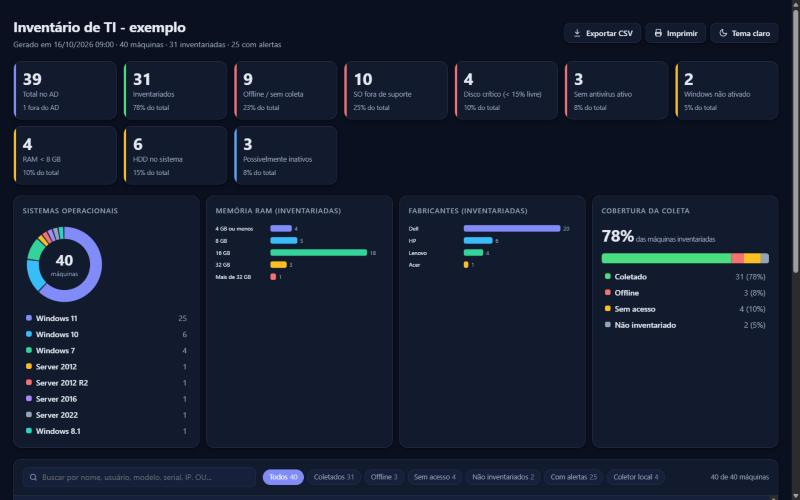
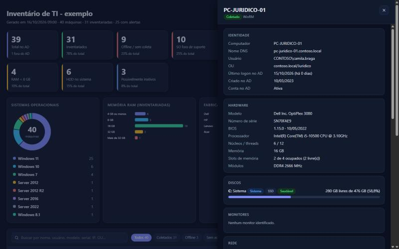

# InventarioTI

[](https://github.com/guifqz/inventario-ti-powershell/actions/workflows/ci.yml)
[](LICENSE)


> **In short:** a PowerShell module that inventories every computer of an Active Directory domain without agents and without RSAT (ADSI discovery, WinRM with DCOM fallback, optional local collector), flags problems (end-of-life OS, full disks, no antivirus, HDD system disks...) and writes CSV, JSON and an offline, interactive HTML dashboard.

Módulo PowerShell para inventário de ativos de TI em domínios Windows. Descobre os computadores no Active Directory (sem instalar RSAT), coleta hardware, discos, sistema operacional, antivírus, monitores, rede e software, em paralelo e sem agente, e gera relatórios em CSV, JSON e um painel HTML interativo.

Nasceu da rotina de quem coordena TI em uma empresa de médio porte: saber, em minutos e sem planilha manual, quais máquinas estão offline, quais discos estão acabando, quais estações ainda rodam Windows sem suporte e quais contas do AD parecem abandonadas.





Exemplo navegável com dados fictícios: [`docs/exemplo-relatorio.html`](docs/exemplo-relatorio.html) (baixe e abra no navegador; funciona offline).

## O que faz

- **Descoberta no AD sem RSAT.** Consulta via ADSI (`System.DirectoryServices`); se existir o módulo `ActiveDirectory`, ele serve de alternativa. Traz nome, DNS, SO e versão no AD, último logon (convertido de `lastLogonTimestamp`), data de criação, descrição, OU e se a conta está habilitada.
- **Coleta que funciona sem WinRM.** `-Protocolo Auto` (padrão) tenta WinRM e cai para DCOM. Antes disso, um ping paralelo (com teste das portas 135/445/5985, para quem bloqueia ICMP) separa as máquinas offline sem esperar timeout.
- **Status honesto por máquina.** Cada registro traz `StatusColeta` (`Coletado`, `Offline`, `AcessoNegado`, `SemWinRMeDcom`, `Erro`, `NaoInventariado`), `ProtocoloUsado` e uma mensagem em português com a correção sugerida.
- **Coletor local + mesclagem.** `tools\Coletar-Local.ps1` roda na própria estação (GPO de inicialização) e grava `<PC>.json` num compartilhamento; `-PastaColetaLocal` mescla esses arquivos com a coleta remota, ficando com o dado mais recente de cada máquina.
- **Mais dados por máquina.** Usuário logado, boot e uptime, fabricante/modelo/serial, BIOS, CPU (núcleos/threads), RAM (slots, tipo, velocidade), discos com SSD/HDD e saúde, SO (build, arquitetura, instalação), ativação, antivírus (ativo/atualizado, só estações), monitores, adaptadores de rede, Office, ferramentas de acesso remoto (AnyDesk, TeamViewer...), reinício pendente e software instalado. Cada consulta falha sozinha e vira `$null`.
- **Alertas calculados em funções puras e testadas:** disco com menos de 15% livre, SO fora de suporte, RAM abaixo de 8 GB, Windows no HDD, disco com saúde ruim, sem antivírus / desativado / desatualizado, Windows não ativado, mais de 30 dias sem reiniciar, conta do AD possivelmente inativa (> 90 dias) e máquina do AD nunca inventariada.
- **Relatório HTML interativo, em um único arquivo, sem CDN nem fontes externas:** cartões clicáveis que filtram a tabela, gráficos SVG (sistemas, RAM, fabricantes, cobertura), busca, ordenação, filtros rápidos, exportação CSV da visão filtrada, gaveta de detalhes por máquina com link direto (`relatorio.html#PC-FINANCEIRO-01`), tema claro/escuro e folha de estilo para impressão.

## Início rápido (domínio Active Directory)

Do PC de trabalho, logado como administrador do domínio, sem RSAT:

```powershell
git clone https://github.com/guifqz/inventario-ti-powershell.git
cd inventario-ti-powershell
.\Inventariar-Rede.ps1 -Saida C:\Inventario

# Baixou o ZIP em vez de clonar? Desbloqueie os scripts antes:
Get-ChildItem -Recurse | Unblock-File
# Se a política de execução bloquear, rode só nesta sessão:
Set-ExecutionPolicy -Scope Process -ExecutionPolicy Bypass
```

Descobre o domínio, sonda a rede, coleta, grava `inventario-AAAAMMDD-HHmm.csv/.json/.html` em `C:\Inventario`, abre o HTML e imprime um resumo no console. Variações:

```powershell
# com coletas locais (máquinas sem WinRM) e só uma OU
.\Inventariar-Rede.ps1 -Saida C:\Inventario -PastaColetaLocal \\SRV-ARQUIVOS-01\Ativos -SearchBase 'OU=Estacoes,DC=contoso,DC=local'

# outra credencial e mais paralelismo
.\Inventariar-Rede.ps1 -Saida C:\Inventario -Credential (Get-Credential) -ThrottleLimit 32

# lista própria, sem AD
.\Inventariar-Rede.ps1 -Saida C:\Inventario -Path .\computadores.txt
```

Estações sem WinRM habilitado (o caso comum) caem no DCOM; se também não tiverem a regra de firewall do WMI, veja [`docs/ativar-winrm-gpo.md`](docs/ativar-winrm-gpo.md) (GPO de WinRM, regra WMI-In e implantação do coletor local por GPO de inicialização).

## Requisitos

- Windows PowerShell 5.1 ou PowerShell 7+ (a coleta é sempre feita a partir de uma máquina Windows).
- PC de inventário no domínio, com um usuário administrador das estações (ou `-Credential`).
- Nas estações, uma das opções: WinRM (5985), DCOM/WMI (135 + RPC dinâmico) ou o coletor local. Detalhes em [`docs/ativar-winrm-gpo.md`](docs/ativar-winrm-gpo.md).
- Opcional: `ImportExcel` para exportar `.xlsx`; o módulo `ActiveDirectory` (RSAT) não é necessário.

## Instalação do módulo

Ainda não está na PowerShell Gallery. Clone o repositório e importe:

```powershell
Import-Module .\InventarioTI\InventarioTI.psd1
```

Para deixar disponível em todas as sessões, copie a pasta `InventarioTI` para `$HOME\Documents\WindowsPowerShell\Modules` (5.1) ou `$HOME\Documents\PowerShell\Modules` (7).

## Uso do módulo

```powershell
Get-InventarioMaquina | Format-List                                   # máquina local

$cred = Get-Credential
Get-InventarioMaquina -ComputerName PC-FINANCEIRO-01 -Credential $cred -IncluirAtivacao

$inventario = Invoke-InventarioRede -DoAD -IncluirAtivacao -ThrottleLimit 24
$inventario = Invoke-InventarioRede -Path .\computadores.txt -SemSoftware
$inventario = Invoke-InventarioRede -OrganizationalUnit 'OU=Estacoes,DC=contoso,DC=local' -PastaColetaLocal \\SRV-ARQUIVOS-01\Ativos

$inventario | Export-InventarioRelatorio -Path .\saida                 # CSV + JSON + HTML
$inventario | Export-InventarioRelatorio -Path .\saida -Formato HTML -LimiteDisco 20

Import-InventarioPasta -Path \\SRV-ARQUIVOS-01\Ativos                  # só os JSON do coletor local
```

Consultas rápidas:

```powershell
$inventario | Where-Object StatusColeta -ne 'Coletado' | Select-Object ComputerName, StatusColeta, Mensagem
$inventario | Where-Object PossivelmenteInativo | Select-Object ComputerName, UltimoLogonAD, OU
$inventario.Software | Group-Object Nome | Sort-Object Count -Descending | Select-Object -First 10
```

### Parâmetros úteis

| Parâmetro | Em | Efeito |
|---|---|---|
| `-DoAD` | `Invoke-InventarioRede` | Todos os computadores habilitados do domínio |
| `-OrganizationalUnit` / `-SearchBase` | `Invoke-InventarioRede` | Limita o AD a uma OU (DN) |
| `-IncluirDesativados` | `Invoke-InventarioRede` | Inclui contas de computador desativadas |
| `-PastaColetaLocal` | `Invoke-InventarioRede` | Mescla os JSON do coletor local (vale o dado mais recente) |
| `-Protocolo` | `Get-InventarioMaquina`, `Invoke-InventarioRede` | `Auto` (padrão), `Wsman` ou `Dcom` |
| `-ThrottleLimit` | `Invoke-InventarioRede` | Máquinas coletadas ao mesmo tempo (padrão 16) |
| `-SemSoftware` | idem | Pula a lista de software (bem mais rápido; Office e acesso remoto ficam vazios) |
| `-IncluirAtivacao` | idem | Consulta a ativação do Windows |
| `-LimiteDisco` | `Export-InventarioRelatorio` | % livre abaixo do qual o disco alerta (padrão 15) |
| `-DataReferencia` | `Export-InventarioRelatorio` | Data usada nas regras de suporte e inatividade (útil em testes) |
| `-WhatIf` | `Export-InventarioRelatorio` | Mostra o que seria gravado, sem gravar |

Ajuda completa: `Get-Help Invoke-InventarioRede -Full`.

## Como funciona

```
Inventariar-Rede.ps1       entrada de um comando: AD -> coleta -> mescla -> CSV/JSON/HTML
tools/
  Coletar-Local.ps1        roda na estação (GPO), grava <PC>.json no compartilhamento
  DadosExemplo.ps1         40 máquinas fictícias (todos os estados e alertas)
  Gerar-Exemplo.ps1        regenera docs/exemplo-relatorio.html
InventarioTI/
  Public/    Get-InventarioMaquina, Invoke-InventarioRede, Export-InventarioRelatorio, Import-InventarioPasta
  Private/
    AD.ps1                 ADSI/Get-ADComputer; DN->OU, UAC, FILETIME, inatividade (puras)
    Rede.ps1               ping + TCP paralelos; classificação de erros e StatusColeta
    Cim.ps1                camada fina sobre CIM/StdRegProv e abertura de sessão (WinRM -> DCOM)
    Coleta.ps1             coleta de cada grupo de dados; cada uma falha sozinha
    Decodificacao.ps1      productState, monitores (EDID), tipo de memória, Office, acesso remoto (puras)
    Alertas.ps1            regras de alerta (puras)
    Mesclagem.ps1          remoto + local + AD em um registro por máquina
    Relatorio.ps1          registros planos (CSV), JSON, modelo e HTML
    Templates/relatorio.html   painel (HTML, CSS e JS próprios; os dados entram como JSON escapado)
```

Decisões de projeto:

- **Lógica pura separada do acesso ao sistema.** Conversões do AD, decodificadores, alertas e regras de mesclagem não tocam CIM, LDAP nem disco; são testadas sem mock.
- **ADSI em vez de Get-ADComputer.** Não exige RSAT nem o ADWS (Active Directory Web Services) no controlador de domínio.
- **Sondagem antes da coleta.** Ping e portas TCP em paralelo classificam o offline em ~1 s e dizem se vale tentar WinRM (5985) ou DCOM (135), evitando esperar timeouts de CIM. Só as portas, não o ICMP, decidem: o firewall do Windows costuma bloquear eco em estações.
- **Falha por máquina não derruba o lote.** Cada consulta opcional vira `$null`; falhas de conexão viram `StatusColeta` com mensagem de correção.
- **Software via `StdRegProv`, não `Win32_Product`.** `Win32_Product` é lento e dispara reconfiguração de pacotes MSI.
- **Paralelismo com RunspacePool**, não `ForEach-Object -Parallel`, para funcionar igual no 5.1 e no 7.
- **Relatório sem dependências.** Um HTML com CSS e JS embutidos; os dados vão em `<script type="application/json">` com `<`, `>`, `&` e separadores Unicode escapados.
- **Fim de suporte do SO** segue as datas publicadas pela Microsoft (Windows 10 em 14/10/2025, Server 2012 R2 em 10/10/2023, etc.). Máquinas com ESU aparecem como "fora de suporte" mesmo assim.
- **RAM baixa** arredonda para cima: 8 GB instalados aparecem como 7,4 a 7,9 GB e não devem alertar.

## Testes

Os testes usam Pester 5 e simulam o CIM e o LDAP com mocks; os marcados `Integracao` coletam a máquina local:

```powershell
Install-Module Pester -RequiredVersion 5.7.1 -Scope CurrentUser -Force -SkipPublisherCheck
Invoke-Pester -Path .\tests
```

Análise estática:

```powershell
Install-Module PSScriptAnalyzer -Scope CurrentUser
Invoke-ScriptAnalyzer -Path . -Recurse -Settings .\PSScriptAnalyzerSettings.psd1
```

Para regenerar o relatório de exemplo: `.\tools\Gerar-Exemplo.ps1`.

> Os arquivos `.ps1`, `.psm1` e `.psd1` são salvos em UTF-8 com BOM (veja `.editorconfig`). O Windows PowerShell 5.1 lê script sem BOM como ANSI e corrompe os acentos.

## Roadmap

- [ ] Publicar na PowerShell Gallery
- [ ] Inventário de impressoras de rede
- [ ] Coleta de status do BitLocker
- [ ] Comparar duas execuções e destacar mudanças (software novo, troca de hardware)
- [ ] Envio do relatório por e-mail e agendamento via Task Scheduler
- [ ] Exportação para SQLite / SQL Server

Sugestões e pull requests são bem-vindos.

## Licença

[MIT](LICENSE) © 2026 Guilherme
